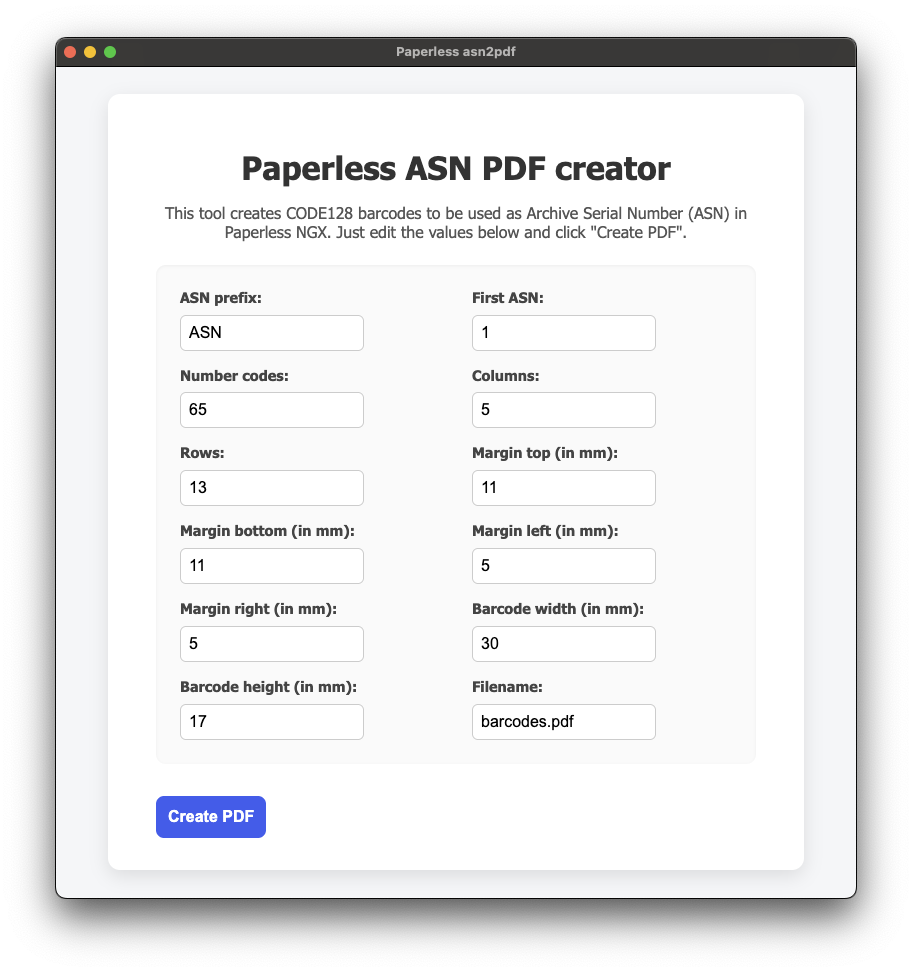
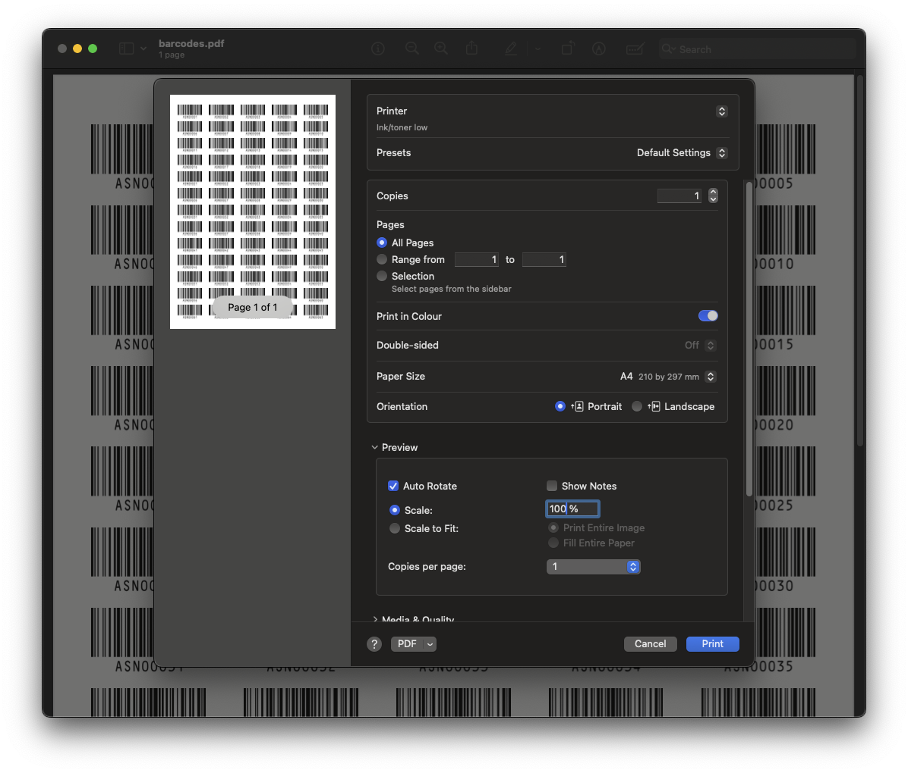
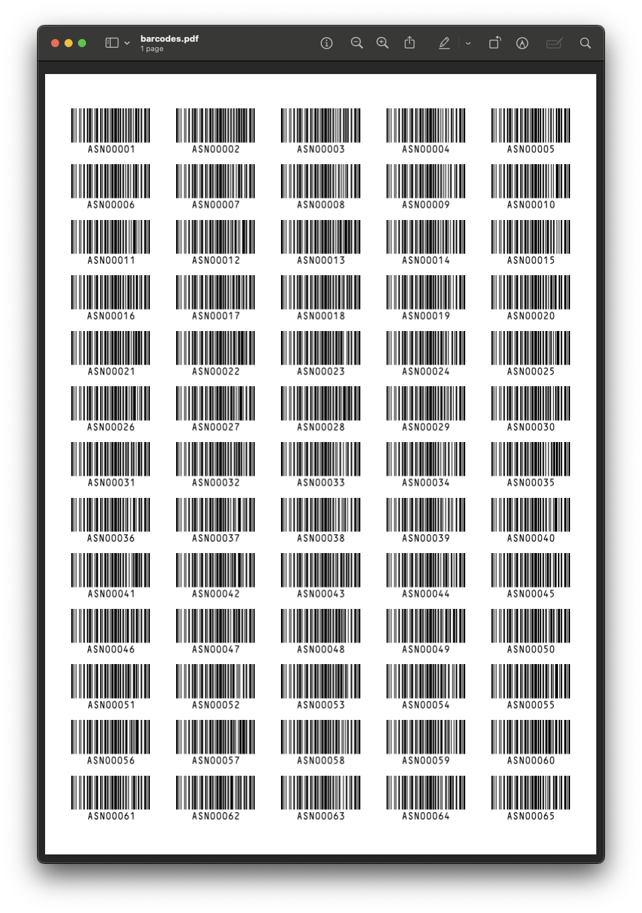

> [!IMPORTANT]
> This repository was archived on November 13th, 2026, because meanwhile there are better tools available such as [asnlabels.com](https://asnlabels.com/).

# Paperless asn2pdf

This project is a basic Electron application to create ASN (Archive Serial Number) barcode stickers in CODE128 format for [Paperless NGX](https://github.com/paperless-ngx/paperless-ngx).

⚠️ **Note:** This project is work in progress. It has not been fully tested or documented yet, and things may still change.

## Run the Application

```bash
cd paperless-asn2pdf
npm start
```

## Building an Executable

1. Clone the repository:
    ```bash
    git clone https://github.com/phipzzz/paperless-asn2pdf.git
    cd paperless-asn2pdf
    ```
2. Install dependencies:
    ```bash
    npm install
    ```
3. Build the executable for your platform:
    ```bash
    npm run dist
    ```

## Requirements

-   Node.js
-   npn
-   electron-builder

## Usage

1. Configuration
   After you started the app, adapt the configuration according to your needs.



2. Print scale
   Ensure you selected 100% scale on your PDF reader when you prepare printing.



3. Result



## Planned features

-   Preconfigured sticker types (e.g. Herma 4504), including all parameters like padding, rows, columns...
-   Improved documentation
-   Update notifications / auto update
-   Prebuild execuatbles for different plattforms
-   Preview options
-   Application hosted on Website

### Maybe features

-   Different code types
-   Start position (row and column) for partial sheets
